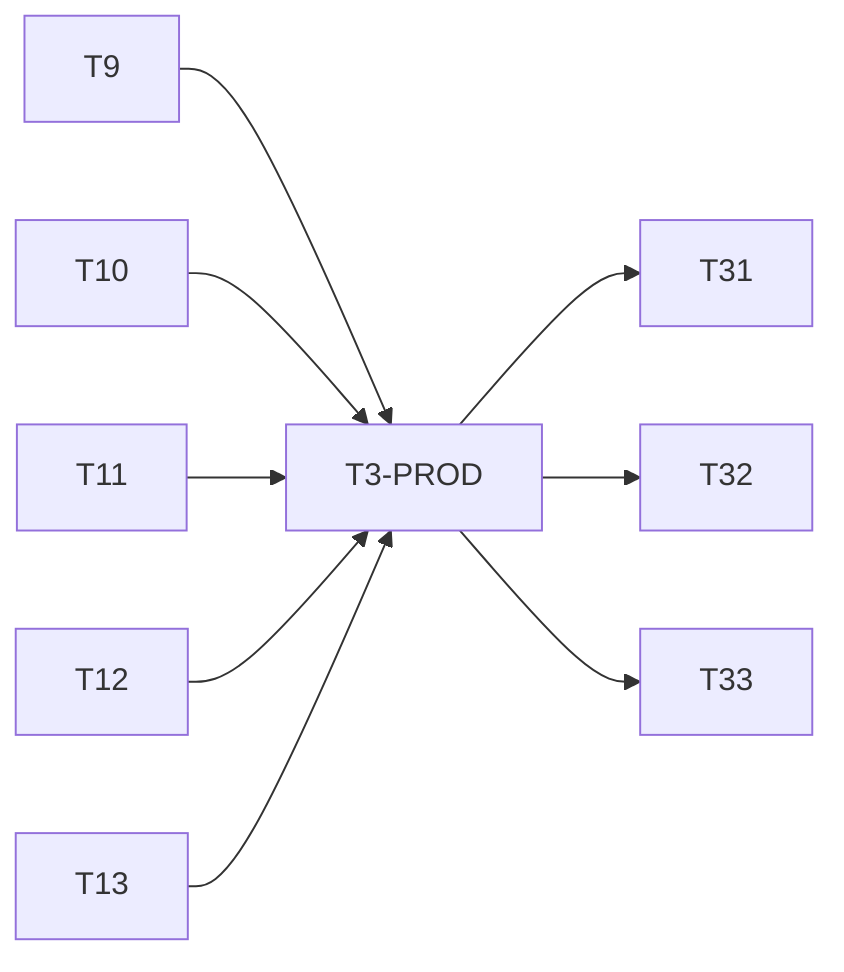

# Plano de implementação — núcleo 1.0

**Status**: revisão técnica anterior APROVADA; execução autorizada em 07/11/2026; revisão da mudança AD-007 APROVADA.
**Atualização vigente**: P0 de viabilidade APROVADO (`rev-p0-fechamento`);
ordem explícita para ajustar divisão T3 e iniciar T9 aplicada. T9 em andamento;
T3-PROD pendente, sem autorização de segredo. Históricos de bloqueio anteriores
não substituem esta ordem. Contagem medida: 36 tarefas principais, 82 edges Tn,
um subgate normativo com oito edges adicionais (90 totais), grafo acíclico.
**Design**: [design.md](design.md). **Spec**: [spec.md](spec.md).
**Cobertura**: [coverage.md](coverage.md). **Revisão**: [review.md](review.md).

## Execution Protocol

Usar a skill `tlc-spec-driven` na execução, com teste derivado do critério antes de
declarar tarefa concluída e revisão independente no fechamento. Esta entrega é
documental. Nenhum comando abaixo foi executado como teste do plugin.

O operador pediu paralelismo: a ordem é o DAG, não serialização artificial de
tarefas independentes. Contratos e arquivos compartilhados têm um único escritor.
Cada worker recebe tarefa, caminhos, IDs, critérios, gate e proibição de ampliar
escopo. Autor não revisa o próprio lote. Integrador confere diffs e provas.

Antes de Execute, confirmar: interpretação de comunicação mínima no projeto,
defaults da spec, matriz de testes proposta e autorização para ambiente descartável,
dependências e migrações locais de teste. Publicação npm/release e licença final
têm gate próprio; autorização Git desta documentação não publica software.

## Test Coverage Matrix

Repo sem código/testes na origem. Convenções abaixo são propostas de bootstrap,
não comandos descobertos em manifests existentes. Não há suite anterior a preservar.

| Code Layer | Required Test Type | Coverage Expectation | Location Pattern | Run Command |
| --- | --- | --- | --- | --- |
| Domain | unit | Todos os critérios e transições aplicáveis; limites e erros | tests/unit/*.test.ts | bun run test:unit |
| Persistence | integration | Concorrência, crash, transações e migração com backup | tests/integration/*.test.ts | bun run test:integration |
| Host adapter | contract | Baseline exata; capabilities, erros e efeitos reais | tests/contract/*.test.ts | bun run test:contract |
| Transports | e2e | Happy path, recusa, origem falsa e equivalência API/tool | tests/e2e/*.test.ts | bun run test:e2e |
| Documentation/package | artifact | Links, schemas, exemplos e tarball limpo | tests/artifact/*.test.ts | bun run test:artifact |

## Gate Check Commands

Comandos a criar em T1; se a baseline exigir outro runtime, atualizar plano e
validar antes de prosseguir. Bun/TypeScript são propostas, não dependências instaladas.

| Gate Level | When to Use | Command |
| --- | --- | --- |
| probe | T2–T8, cenário explicitamente selecionado | bun run probe -- <scenario> |
| quick | Serviço isolado | bun run typecheck && bun run test:unit |
| full | Persistência/integração/transport | bun run typecheck && bun run test:unit && bun run test:integration && bun run test:contract && bun run test:e2e |
| build | Bootstrap e joins | bun run build && bun run lint && bun run test:artifact |
| release | Candidato completo | Todos os gates anteriores + instalação limpa do tarball + aceite sintético |

T1 registra contagem inicial de testes; a partir daí cada tarefa informa contagem
antes/depois, IDs cobertos e skips justificados. Não inventar contagens antes de
existirem testes. Um critério de cobertura não implica teste já executado.

## Execution Plan

| Fase | Tarefas | Saída/gate | Paralelismo |
| --- | --- | --- | --- |
| P0 — Viabilidade | T1–T8 | Baseline, auth, idempotência, lifecycle e scheduler; limites de exclusão registrados | T3–T8 após snapshot, em fixtures independentes |
| P1 — Fundação | T9–T13 | Contratos, banco, autorização, grants e operações | T12 e T13 após suas dependências |
| P2 — Gestão | T14–T18 | Descoberta, grupos, criação e lifecycle | T14/T15; T16/T17/T18 isolados |
| P3 — Comunicação | T19–T22 | Inbox, dispatch, resposta e eventos | Eventos em paralelo à mensageria |
| P4 — Orquestração | T23–T25 | DAG, execução e perguntas | DAG pode iniciar após P1/grupos sem esperar P3 inteiro |
| P5 — Contexto/automação | T26–T29 | Export/import, memória e jobs | Contexto, memória e jobs em frentes distintas |
| P6 — Interfaces/uso | T30–T33 | Uso, tools, API e comandos | T31/T32 em paralelo após serviços; T30 antecipa |
| P7 — Release | T34–T36 | Docs, licença, pacote e verificação | Docs após T33; somente redação jurídica antecipável |

P0 é gate de viabilidade T1–T8, APROVADO pelo revisor no lote
`rev-p0-fechamento` (45 contract / 401 assertions, evidência recebida).
Ordem atual do operador: aplicar divisão T3-P0/T3-PROD e iniciar T9.
Ausência de auth de produto não autoriza fallback inseguro. Não declarar
1.0 completa enquanto requisito ativo obrigatório estiver `unsupported`. Exclusão exata
não bloqueia a 1.0: LIF-08/09/10 deferred por AD-007, sem implementação do produto.
Para scheduler, T6 fundamenta a escolha técnica pelo próprio no
[contrato de arquitetura](../../../docs/architecture/scheduler.md), nunca ambos por job.
AD-008 resolve boundary SCH-05/06 como LOCAL; P0 aprovado não certifica
implementação do scheduler ou autenticação de produto e não altera AD-007.

### DAG autoritativo

Cada seta abaixo corresponde a `Depends on`. Fases agrupam trabalho; só o DAG
determina bloqueios. Entrypoint, schema e lockfile são integrados por um escritor.
T3 é o identificador principal preservado para o gate T3-P0; a seta T3 -> T9
significa exclusivamente viabilidade aprovada, não aceite de produto.

```text
T1 -> T2
T2 -> T3
T2 -> T4
T2 -> T5
T2 -> T6
T2 -> T7
T2 -> T8
T3 -> T9
T4 -> T9
T5 -> T9
T6 -> T9
T7 -> T9
T8 -> T9
T9 -> T10
T9 -> T11
T10 -> T11
T11 -> T12
T10 -> T13
T11 -> T13
T11 -> T14
T10 -> T15
T11 -> T15
T12 -> T16
T13 -> T16
T14 -> T16
T12 -> T17
T13 -> T17
T14 -> T17
T5 -> T18
T12 -> T18
T13 -> T18
T14 -> T18
T12 -> T19
T13 -> T19
T19 -> T20
T20 -> T21
T10 -> T22
T11 -> T22
T13 -> T22
T15 -> T23
T13 -> T23
T20 -> T24
T23 -> T24
T12 -> T25
T24 -> T25
T12 -> T26
T14 -> T26
T13 -> T27
T26 -> T27
T10 -> T28
T12 -> T28
T6 -> T29
T12 -> T29
T24 -> T29
T8 -> T30
T15 -> T30
T24 -> T30
T16 -> T31
T17 -> T31
T18 -> T31
T21 -> T31
T22 -> T31
T25 -> T31
T27 -> T31
T28 -> T31
T29 -> T31
T30 -> T31
T16 -> T32
T17 -> T32
T18 -> T32
T21 -> T32
T22 -> T32
T25 -> T32
T27 -> T32
T28 -> T32
T29 -> T32
T30 -> T32
T31 -> T33
T32 -> T33
T33 -> T34
T34 -> T35
T35 -> T36
```

## Task Breakdown

Cada tarefa entrega um componente coeso com seus testes; `Where` é o arquivo
principal, não dispensa testes colocalizados em `tests/` nem ajustes mínimos de
registro pelo integrador. Nenhuma frente altera o módulo de outra em paralelo.
`coverage.md` é a fonte autoritativa de atribuição ID→implementação→cenário. O
campo Requirement também pode citar critérios que uma prova ou componente apoia,
sem substituir a responsabilidade de implementação registrada na matriz.

### Phase 0: Viabilidade técnica

### T1: Bootstrap do ambiente descartável
**What**: Criar harness de build/testes e servidor isolado, depois de aprovação de dependências/configuração.
**Where**: `package.json`
**Depends on**: None
**Requirement**: API-10, REL-02
**Done when**: runtime e versões fixados; scripts da matriz e runner `probe` existem; fixture inicia/encerra sem tocar servidor de trabalho; teste artifact verifica exclusão de segredos do pacote.
**Tests**: artifact e integração do harness.
**Gate**: build; não declarar capacidades do produto.

### T2: Fotografar contrato do host
**What**: Registrar versão efetiva, schemas usados e hash do OpenAPI servido em ambiente isolado.
**Where**: `scripts/probes/contracts.ts`
**Depends on**: T1
**Requirement**: API-10
**Done when**: diferenças docs/binário registradas e baseline candidata escolhida sem pressupor que CLI identifica servidor.
**Tests**: contract; fixture com capability ausente retorna unsupported.
**Gate**: probe contracts.

### T3: Provar viabilidade de principal e autorização (T3-P0)
**What**: Demonstrar contexto confiável de tool e viabilidade do canal de operador,
com limites do host e obrigações de produto separados. Identificador T3 preservado.
**Where**: `scripts/probes/identity.ts` (export `probeToolIdentity`, cenário `tool-identity`), `scripts/probes/operator-channel.ts`, `scripts/probes/fixtures/tool-provider.ts`, demais fixtures em `scripts/probes/fixtures/`, evidências em `docs/compatibility/identity.md`.
**Depends on**: T2
**Requirement**: SES-01, ACL-02/06/07/11, API-11/12
**Done when**: contexto tool demonstrado no host 2.2.5, claims recebidos ignorados,
transporte RPC não promovido a operador; listener em setup com callback lexical
privado, unload/cleanup e viabilidade administrativa documentados em
`docs/compatibility/identity.md`; limitações host registradas sem prometer auth
de produto. Obrigações completas de hardening/provisionamento ficam em T3-PROD.
**Tests**: contract/e2e negativos contra host de teste.
**Gate**: probes identity (tool-identity via export probeToolIdentity) e
operator-channel; APROVADO na revisão `rev-p0-fechamento`, 45 contract / 401
assertions no lote completo. Nenhum teste reexecutado nesta alteração documental.

Fronteira P0: probes de viabilidade T1–T8, sem exigir aceites de implementação
de produto T31–T36 antecipadamente (isso criaria ciclo). Registrar limitações do
host separadas da viabilidade do desenho e dos aceites futuros nas respectivas
tarefas. P0 agora aprovado e T9 autorizado pela ordem explícita atual; auth de
produto não está aprovada. Mock não prova segurança de produto.

#### Subgate normativo T3-PROD — produto, autenticação e provisionamento

Não é tarefa T37: preserva mapeamento e IDs T1–T36. Este subgate de T3 é
independente do aceite de viabilidade T3-P0 e obrigatório nos joins de produto.

| Gate | Depende de | Bloqueia | Estado |
| --- | --- | --- | --- |
| T3-P0 (ID T3) | T2 | T9, junto de T4–T8 | APROVADO, rev-p0-fechamento |
| T3-PROD | T9, T10, T11, T12, T13 | T31, T32, T33 e qualquer emissão de segredo | PENDENTE |

**Contrato de produto obrigatório**: autenticação de operador própria separada de
sessões e transporte nativo, digest/comparação constante, capabilities/escopo,
revogação e redação; nenhuma promoção por input, tools ou comando de agente.
Comprovar comando humano versus agente e always/autoconfiguração com origem
confiável, mantendo fail-closed onde não houver prova. Gateway no setup/mesmo
processo e callback lexical privado não RPC/tool; bind 127.0.0.1, porta allowlisted
não publicada em RPC/tool de produto, Host/Origin, limite streaming antes de
alocar, timeout/rate limit, anti-replay nonce/body/op/instância/prazo com consumo
atômico e cleanup unload/restart. Gateway separado assinado apenas alternativa
revisada. Shell irrestrito fora do isolamento; loopback não autentica.

Implementar e testar usando fundação T9–T13, mocks somente como fixtures;
revisão independente do código e testes negativos exigida antes de T31/T32/T33.
Armazenamento/provisionamento, recuperação/rotação e isolamento SO/broker devem
ser revisados ANTES de qualquer segredo real. Emissão continua exclusivamente
humana posterior e exige autorização própria; esta ordem não autoriza segredo.
API-11/12 e demais critérios ativos continuam obrigatórios, não deferred.
Contrato completo: `docs/architecture/operator-auth.md` e design vigente.

Edges adicionais autoritativos do subgate (complementam o DAG Tn, sem ciclo):



### T4: Provar entrega e recuperação
**What**: Medir admissão, queue, resume, correlação e reconciliação após timeout.
**Where**: `scripts/probes/delivery.ts`
**Depends on**: T2
**Requirement**: MSG-02/05/06/07, REL-02
**Done when**: recibos e fronteira de não retorno conhecidos; notificação não inicia modelo; repetição incerta não gera reenvio cego.
**Tests**: contract com host idle/busy e perda de resposta injetada.
**Gate**: probe delivery.

### T5: Provar ciclo de vida e exclusão
**What**: Demonstrar parentID, fork, controle, archive e limite de cascata concorrente.
**Where**: `scripts/probes/lifecycle.ts`
**Depends on**: T2
**Requirement**: LIF-01..07/11..13, REL-03/04; LIF-08/09/10 somente investigação histórica deferred
**Done when**: capacidades e limites de lifecycle registrados. Preservar o NO-GO de exclusão exata e a corrida com escritor externo em [T5 lifecycle](../../../docs/compatibility/lifecycle.md), sem reescrever achados runtime. AD-007 retira exclusão do produto da 1.0; DELETE só no probe sintético autorizado, não em serviço de produto.
**Tests**: contract apenas em família sintética; apagar fixture exige autorização do ambiente descartável.
**Gate**: probe lifecycle.

### T6: Decidir backend de agenda
**What**: Comparar garantias nativas com SCH-01..10 e escolher um executor.
**Where**: `scripts/probes/schedules.ts`
**Depends on**: T2
**Requirement**: SCH-01..10
**Done when**: flag, reinício, ocupado, revogação e DST medidos; nativo aprovado ou backend próprio justificado no design antes de T9.
**Tests**: contract com relógio controlado e duas localizações.
**Gate**: probe schedules.

**Decisão documental pós-probe**: scheduler próprio, conforme
[evidência runtime e fontes públicas T6](../../../docs/compatibility/schedules.md) e
[contratos para T9/T29](../../../docs/architecture/scheduler.md). O timer nativo
funcionou; não oferece o gate transacional por ocorrência do plugin. Não declarar
SCH-05/06 aprovados apenas pelo timer: AD-008 decide admissão local versus host,
mas implementação e provas de concorrência continuam nas tarefas respectivas;
docs AD-008/009 aprovadas, viabilidade P0 aprovada em rev-p0-fechamento.

### T7: Provar portabilidade
**What**: Validar export/import e limites de projeção do transcrito.
**Where**: `scripts/probes/portability.ts`
**Depends on**: T2
**Requirement**: CTX-01..04/07/08
**Done when**: round-trip sintético, conflito de IDs e falha parcial registram perdas e IDs conhecidos sem duplicação.
**Tests**: contract e integração com fixtures adulteradas.
**Gate**: probe portability.

### T8: Provar dados de uso
**What**: Determinar fontes e qualidade de tokens, custos, atividade e eventos.
**Where**: `scripts/probes/usage.ts`
**Depends on**: T2
**Requirement**: API-02..07
**Done when**: campos ausentes distinguíveis de zero; replay e limites do stream documentados; fonte por métrica definida.
**Tests**: contract com fixture de custo conhecido e desconhecido.
**Gate**: probe usage.

### Phase 1: Fundação

### T9: Congelar contratos de domínio
**Alias de dependência**: T3 no campo Depends on abaixo significa T3-P0 aprovado;
T3-PROD não bloqueia T9 e depende de sua fundação (não há dependência reversa).
**What**: Definir schemas versionados, ports, enums e erros a partir das provas.
**Where**: `src/contracts/index.ts`
**Depends on**: T3, T4, T5, T6, T7, T8
**Requirement**: API-01/08/10, REL-05
**Done when**: entradas inválidas rejeitadas; estados correspondem à spec; consumers usam ports e não DTO interno do host; decisões P0 integradas; contrato do detector de ownership de DB canônico entre localizações define recusa de ownership divergente/ambíguo e testes negativos, sem alegar fencing no host.
**Tests**: unit/contract para schemas e matriz de transições.
**Gate**: quick + build.

**Status**: CONCLUÍDA, implementação e revisão independente APROVADAS. Integrador:
9 testes unitários/215 assertions; revisor: suíte completa 64 testes/742 assertions.
T3 no Depends on é T3-P0, não T3-PROD. Esses resultados não são aceite do produto.
AD-007 e docs AD-008/009 APROVADOS; aceites de produto permanecem nas tarefas.

### T10: Persistência transacional
**Status**: implementação e revisão independente APROVADAS em 08/11/2026;
migrações restritas a bancos sintéticos próprios. Gate E2E/full global segue
NÃO VALIDADO (`NOT_IMPLEMENTED`), não é aceite de release. Revisor: T10 4/33,
unit 9/215, integração 11 testes, contratos 45/401; build/lint/typecheck passaram.
**What**: Implementar storage próprio, schema versionado e transações.
**Where**: `src/persistence/database.ts`
**Depends on**: T9
**Requirement**: REL-01/02, CTX-05, SCH-06
**Done when**: banco fora do repo; criação/migração com backup testado; falha de gravação impede efeitos; rollback e concorrência comprovados.
**Tests**: integration com dois processos, crash e banco indisponível.
**Gate**: full.

### T11: Autorizador e principals
**Status**: implementação e revisão independente APROVADAS; integrador reexecutou
13 testes próprios/72 assertions. Revisor confirmou unit 21/279, integração 12
testes, contratos 45/401, lint/typecheck. E2E/full global segue NÃO VALIDADO.
**What**: Aplicar interseção de política, perfil, grant e identidade comprovada.
**Where**: `src/authorization/authorize.ts`
**Depends on**: T9, T10
**Requirement**: ACL-02/03/06/07/10/11, LIF-12/13, API-11
**Done when**: matriz allow/deny cobre self/other, perfis e política restringida; negação não vaza sessão externa; operador não é inferido do texto.
**Tests**: unit e integration; principal falso, delegação excessiva e approvals salvas.
**Gate**: full.

### T12: Grants e solicitações de acesso
**Status**: implementação e revisão independente APROVADAS. Revisor: alvo T12
6 testes/49 assertions; unit 28/311, integração 34 testes, contratos 45/401.
E2E/full global continua NÃO VALIDADO. Integração outbox tem revisão própria T13.
**What**: Implementar link/unlink e ciclo de pedidos ao operador.
**Where**: `src/authorization/grants.ts`
**Depends on**: T11
**Requirement**: ACL-01/02/04/05/08/09
**Done when**: grant direcional; expiração 24h de pedidos; revogação rejeita pendências; já admitido informado; revisão/auditoria persistidas.
**Tests**: unit/integration com corrida revoke/dispatch e solicitação duplicada.
**Gate**: full.

### T13: Operações idempotentes e outbox
**Status**: implementação e revisão independente APROVADAS; alvo T13 19 testes/
110 assertions reexecutados pelo integrador e revisor. Unit 28/311 e contratos
45/401 confirmados pelo revisor. E2E/full global NÃO VALIDADO; sem release.
**What**: Persistir operações, chave/hash, leases e reconciliação.
**Where**: `src/persistence/operations.ts`
**Depends on**: T10, T11
**Requirement**: MSG-05/06, REL-01/02/05
**Done when**: mesma chave retorna operação; payload distinto conflita; crash pós-chamada mantém incerteza; worker antigo não efetua nova admissão.
**Tests**: integration com falhas antes/depois de cada fronteira transacional.
**Gate**: full.

### Phase 2: Gestão

### T14: Descoberta e árvore
**Status**: implementação e revisão independente APROVADAS; revisor confirmou
unit 37/355, contrato 46/429, integração 37 testes e artifact 3 testes. E2E/full
global não certificado; adapters T18/T31 têm tarefas próprias.
**What**: Resolver current/list/get/tree com escopo e paginação.
**Where**: `src/sessions/discovery.ts`
**Depends on**: T11
**Requirement**: SES-01..04/06, REL-03
**Done when**: até 100 itens/cursor, nenhum histórico implícito, ciclos não duplicam IDs e sessão removida é reconhecida.
**Tests**: unit/contract com dois projetos e vínculos cíclicos.
**Gate**: full.

### T15: Grupos e associação
**Status**: implementação e revisão independente APROVADAS; alvo T15 5 testes/
29 assertions, lint/typecheck confirmados pelo revisor. Active-work adapter real
T23/T29 e E2E/full global permanecem pendentes; associação não concede grants.
**What**: Persistir grupos/sistemas e memberships sem conceder acesso.
**Where**: `src/groups/service.ts`
**Depends on**: T10, T11
**Requirement**: SES-05
**Done when**: remover grupo com tarefa/job ativo conflita; remover membro não revoga grant nem exclui sessão; autoria/escopo conferidos.
**Tests**: unit/integration incluindo grupos sobrepostos.
**Gate**: full.

### T16: Criação e fork
**Status**: domínio refatorado e revisão independente APROVADA; alvo 18 testes/
176 assertions confirmado por integrador e revisor. Delivery usa T13; tabela
session_creation_plans guarda apenas plano, observação e vínculo. Fork aceita ID
do host; raiz/filha usam ID planejado. Extensão T11 delegatedOperation foi feita
pelo dono de autorização com aprovação do integrador e revisão independente.
T31 deve provar DTOs reais, correlação de inspect, consumo cross-project e ausência
de herança de grants/jobs. Host real, auth de produto e E2E/full não certificados.
**What**: Criar raiz/filha/fork com delegação explícita e recuperação parcial.
**Where**: `src/sessions/create.ts`
**Depends on**: T12, T13, T14
**Requirement**: LIF-01/02/11/13
**Done when**: excesso de grant recusado antes do host; ausência de autorização aguarda operador; outro projeto cria raiz vinculada; fork não copia grants/jobs.
**Tests**: integration/contract com crash entre criar e registrar vínculo.
**Gate**: full.

### T17: Controles de sessão
**Status**: domínio implementado e revisão independente APROVADA, inclusive
endurecimento de erros e rollback local; revisor alvo 17 testes/88 assertions.
Adapters nativos/jobs/perfis e E2E/full global pendentes, sem certificado de produto.
**What**: Implementar rename/model/agent/style/interrupt/archive/restore/compact/reset.
**Where**: `src/sessions/control.ts`
**Depends on**: T12, T13, T14
**Requirement**: LIF-03..07/12, ACL-06/10/11
**Done when**: observar resultado do host; futuras execuções usam configuração; archive suspende jobs; reset cria sucessora distinta; profiles respeitam teto.
**Tests**: unit/contract; sessão busy, aguardando aprovação, modelo inválido e alteração concorrente.
**Gate**: full.

### T18: Exclusão externa, tombstones e limpeza própria
**Status**: domínio e delta de guard/canonical APROVADOS por revisão independente.
Revisor alvo reconcile+canonical 13 testes/127 assertions; guardas novos trabalhos
e composição Discovery reais testados em SQLite sintético. Sem DELETE ao host.
Wiring de produção deve injetar removedTargetPort real; E2E/full global pendente.
**What**: Detectar sessão removida externamente, bloquear pendências, registrar tombstone e limpar conteúdo associado exclusivamente no storage próprio.
**Where**: `src/sessions/reconcile.ts`
**Depends on**: T5, T12, T13, T14
**Requirement**: REL-03/04
**Done when**: destino removido é recusado; pendências bloqueadas; tombstone e limpeza própria idempotentes sobrevivem a reinício; auditoria mínima sem payload preservada. Nenhuma chamada DELETE ao host nem ferramenta/comando/API delete-preview/delete-confirm. Retenção própria permanece distinta da exclusão de sessão host.
**Tests**: contract/integration com remoção externa de fixture sintética autorizada, reconciliação repetida, reinício e verificação de ausência de DELETE pelo produto.
**Gate**: full; prova T5 informa limites do host, não exige exclusão exata do produto.

### Phase 3: Comunicação

### T19: Inbox e envelope
**Status**: domínio implementado e revisão independente APROVADA; alvo T19
20 testes/73 assertions confirmado pelo revisor. Notificação sem host/wake por
construção. Expiração terminal de intents pendentes fica em T20; cursor de inbox
e wiring real em T31/T33. E2E/full e autenticação de produção não certificados.
**What**: Armazenar mensagens sem despertar modelo e expor inbox autorizada.
**Where**: `src/messaging/inbox.ts`
**Depends on**: T12, T13
**Requirement**: MSG-01/02/09
**Done when**: limite UTF-8 64 KiB; notificação disponível sem nova execução; grant e validade checados; payload não entra em logs.
**Tests**: unit/integration com limites 65536/65537 bytes e destinatário busy.
**Gate**: full.

### T20: Dispatcher de prompts
**Status**: domínio/correções APROVADOS por revisão independente; alvo 24 testes/
169 assertions confirmado pelo integrador e revisor. Expiração dirigida/indexada,
FIFO entre processos e rollback once provados. Adapter nativo, sweep periódico
de expirePending/recover e E2E/full permanecem pendentes para integração.
**What**: Admitir requests no host, serializar queue por destino e reconciliar incerteza.
**Where**: `src/messaging/dispatcher.ts`
**Depends on**: T19
**Requirement**: MSG-03/05/06/07/08, ACL-04/05
**Done when**: FIFO do plugin preservado; limite 8 saltos; revogação e timeout respeitam fronteira provada; retry sem duplicação lógica.
**Tests**: integration/contract com concorrência e perda de recibo.
**Gate**: full.

### T21: Respostas e espera
**Status**: domínio implementado e revisão independente APROVADA; alvo 12 testes/
79 assertions confirmado pelo integrador/revisor. Sem polling de modelo.
T31 deve prover endereço de retorno para requests originados por operador (hoje
unavailable fail-closed); T31/T32 devem conectar fan-out de commits/ACL/remoção
entre instâncias no ReplyWakePort. E2E/full global e auth de produto pendentes.
**What**: Correlacionar reply, recibos e wait sem polling de modelo.
**Where**: `src/messaging/replies.ts`
**Depends on**: T20
**Requirement**: MSG-04/10
**Done when**: origem/destino verificados, reply não forja autor; wait retorna em até 30s com cursor pendente; resultado não depende de idle.
**Tests**: unit/integration com correlação inválida, timeout e resposta duplicada.
**Gate**: full.

### T22: Journal e replay
**Status**: domínio implementado e revisão independente APROVADA; alvo 16 testes/
79 assertions confirmado por integrador/revisor. Emissores ainda devem conectar
appendInTransaction ao DB canônico (guard de ownership obrigatório na integração).
Compactação de cursores e API de ressincronização pendentes; E2E/full não certificado.
**What**: Expor eventos persistidos com filtro de escopo e retenção.
**Where**: `src/observability/events.ts`
**Depends on**: T10, T11, T13
**Requirement**: API-02/03/08, REL-02
**Done when**: catálogo da spec, cursor crescente, retenção 30d e expired; revogação remove visibilidade no replay; reload não duplica listeners.
**Tests**: integration com desconexão, autorização alterada e cursor antigo.
**Gate**: full.

### Phase 4: Orquestração

### T23: Grafo de tarefas
**Status**: domínio e correção de FKs APROVADOS por revisão independente; alvo
tasks+groups 19 testes/154 assertions confirmado por integrador/revisor.
Cascatas limitadas a metadados do plugin; DBs já existentes exigem migração nova
de rebuild de FKs na composição T31/T34. E2E/full global não certificado.
**What**: Persistir tarefas, dependências e revisões do DAG.
**Where**: `src/orchestration/tasks.ts`
**Depends on**: T15, T13
**Requirement**: TSK-01/02/06, REL-05
**Done when**: ciclo rejeitado; falha bloqueia dependentes; replanejamento explícito valida novo DAG; estados finais não reabrem.
**Tests**: unit/integration com fork/join, ciclos e alterações concorrentes.
**Gate**: full.

### T24: Executor de tarefas
**Status**: domínio e revisão independente APROVADOS; alvo 25 testes/122 assertions
confirmado por integrador/revisor. Dispatcher/host/outcome sintéticos nesses testes;
composição nativa e notificação de resultado à origem em T31/T32, E2E/full pendentes.
**What**: Admitir tarefas prontas e acompanhar resultado/cancelamento.
**Where**: `src/orchestration/runner.ts`
**Depends on**: T20, T23
**Requirement**: TSK-03/04/05/07
**Done when**: limites 4 concorrentes/profundidade 4; resultado final explícito; cancel_requested até confirmação; join não antecipa dependência.
**Tests**: integration/contract; ports de perguntas/uso testados por contrato, integração real em T31/T32.
**Gate**: full.

### T25: Perguntas e aprovações
**Status**: domínio e correções APROVADOS por revisão independente; alvo 20 testes/
144 assertions confirmado pelo integrador, mais contrato runner 2/11 pelo revisor.
Auditoria preservada no cleanup. T31/T32 devem usar questionsRunnerPort(requests),
canal humano autenticado e expire periódico. Banco com descriptor antigo exige
rebuild versionado explícito de question_audit sem FK cascata, com teste de upgrade.
Autenticação de produto e E2E/full permanecem pendentes.
**What**: Gerenciar solicitações com respondente esperado e estados de espera.
**Where**: `src/orchestration/requests.ts`
**Depends on**: T12, T24
**Requirement**: TSK-08/09, ACL-08/09/11
**Done when**: resposta indevida recusada; aprovação humana não vem de agente; resolução retoma tarefa correta; expiração não concede acesso.
**Tests**: unit/integration com principal falso e resposta duplicada.
**Gate**: full.

### Phase 5: Contexto e automação

### T26: Exportador de contexto
**Status**: domínio e revisão independente APROVADOS; alvo 8 testes/25 assertions
confirmado por integrador/revisor. Envelope textual com perdas explícitas, hash
de integridade sem autenticar origem. Wiring nativo T31/T32 e E2E/full pendentes.
**What**: Produzir pacote selecionado e transcrito nativo autorizado.
**Where**: `src/context/export.ts`
**Depends on**: T12, T14
**Requirement**: CTX-01/04
**Done when**: versão/origem/hash presentes; configuração sensível/grants ausentes; perdas e ausência de filesystem explícitas.
**Tests**: unit/contract com conteúdo sintético e autorização insuficiente.
**Gate**: full.

### T27: Importador idempotente
**Status**: domínio AD-010 APROVADO pelo revisor, 43 testes/328 assertions; root
v23 APROVADA, 15/77. Adapter nativo 6/28 aprovado; refinamento do autor 10/47
com follow-up independente pendente. Evidência recebida, sem teste executado
nesta atualização. Fixture/native-shaped e adapter não certificam execução
nativa real ou E2E/full de produto. Reabertura anterior superada para domínio;
lote 26/218 histórico. Integração/aceite native-full permanecem pendentes.
**What**: Validar pacote e importar com ledger de efeitos; separar nova sessão
por lote nativo completo de anexo próprio associado à sessão sem execução host.
**Where**: `src/context/import.ts`
**Depends on**: T13, T26
**Requirement**: CTX-02/03/07/08
**Done when**: limite 10 MiB/hash/versão validados antes de persistência/efeito;
create integra lote nativo completo em nova sessão com preflight inteiro; append
persiste anexo no storage plugin associado à sessão e ferramenta explícita
autorizada o recupera exigindo `context.read` E `read`, principal corrente e
validação de owner/target, sem reescrever histórico nativo nem executar no host;
parcial retorna operationID/IDs tipados sem inventar IDs nativos; replay não
duplica sessão/anexo nem concede grants. Adapter parcial não é native-full.
**Tests**: integration/contract create whole-batch e append attachment; leitura
autorizada com `context.read` E `read` e owner/target para principal corrente;
negar capability ausente (inclusive só context.read), principal/owner/target
divergentes; anexo não concede grants; zero execução/mutação histórica host em append;
ID em conflito, filho órfão, interrupção parcial e replay.
**Gate**: full.

### T28: Memória compartilhada
**Status**: domínio e revisão independente APROVADOS; integrador alvo 2 testes/
29 assertions. CAS entre conexões, expiração e manutenção explícita conferidos
pelo revisor. Adapters de membership/scheduler e E2E/full global pendentes.
**What**: Implementar quadro por escopo com compare-and-swap e expiração.
**Where**: `src/context/memory.ts`
**Depends on**: T10, T12
**Requirement**: CTX-05/06
**Done when**: revisão conflitante rejeitada; expirado deixa de ser lido imediatamente; tombstone em até 60s de serviço ativo.
**Tests**: unit/integration com relógio controlado e dois escritores.
**Gate**: full.

### T29: Serviço de agendamento
**Status**: domínio e follow-ups supervisionados APROVADOS por revisão independente;
alvo final 40 testes/3679 assertions confirmado por integrador/revisor.
Once vinculada ao operationID real com faceta da ocorrência, rollback integral
e nova aprovação por ocorrência provados. One-shot rejeitado/bloqueado esgota sem
alegar sucesso; admitted/unknown continua ativo. Wiring real/E2E pendentes.
**What**: Implementar scheduler próprio escolhido após T6, conforme [contrato](../../../docs/architecture/scheduler.md), com contrato uniforme de jobs.
**Where**: `src/schedules/service.ts`
**Depends on**: T6, T12, T24
**Requirement**: SCH-01..10, LIF-06
**Done when**: occurrenceID estável por jobID/scheduleRevision/dueIndex; intervalo ancorado; SCH-09; no máximo um pending e uma recuperação; não overlap por job; grantRevision reavaliada na admissão local; outbox/idempotência/lease com fencing no DB e ownership único entre localizações comprovados. Condições executáveis unsupported; pause/cancel não desfaz admitted; unknown_outcome não é repetido cegamente. Nenhuma promessa de atomicidade SQLite/host ou exactly-once externo.
**Tests**: unit/integration/contract derivados da matriz do contrato, com relógio virtual, reinício, duas localizações, worker expirado, revogação concorrente e perda de resposta; testes futuros, não executados por esta documentação.
**Gate**: full + revisão independente de produto; AD-008 autoriza grant/revisão e lease na admissão LOCAL serializada. Provar CAS/ownership/revalidação e unknown_outcome sem retry cego; sem fencing/CAS do host não prometer atomicidade externa. P0 de viabilidade já aprovado, não substitui este aceite de produto.

### Phase 6: Interfaces e consumo

### T30: Uso e orçamento
**Status**: domínio e correções APROVADOS por revisão independente; alvo 11 testes/
128 assertions confirmado por integrador/revisor. Snapshot cumulativo explícito,
budget mutation idempotente e budget.changed com operationID provados.
Antes de T31/T32: expor reservas órfãs só ao operador, liberação explícita auditada
(nunca refund automático por timeout), retenção de receipts/chaves e correlação
de remoção externa. Wiring nativo/credenciais/E2E/full global não certificados.
**What**: Agregar uso deduplicado e aplicar teto persistente por grupo.
**Where**: `src/observability/usage.ts`
**Depends on**: T8, T15, T24
**Requirement**: API-04..07/13
**Done when**: custo nulo sem fonte, estimado/reportado distintos; grupo sobreposto deduplicado; alteração só operador; orçamento desconhecido com teto bloqueia admissão.
**Tests**: unit/integration com admissões concorrentes e evento budget.changed.
**Gate**: full.

### T31: Ferramentas nativas
**Depends on supporting gate**: T3-PROD (subgate normativo de T3; obrigatório,
além das dependências Tn abaixo; T3-P0 não o substitui).
**What**: Registrar ferramentas sobre todos os serviços com principal autenticado.
**Where**: `src/transport/tools.ts`
**Depends on**: T16, T17, T18, T21, T22, T25, T27, T28, T29, T30
**Requirement**: API-01/08/10, SES-01
**Done when**: superfície do design disponível com schemas; namespace efetivo documentado; integração real de todos os ports; cancelamento e cleanup funcionando.
**Tests**: e2e/contract com servidor descartável, nunca credenciais de trabalho.
**Gate**: full + build.

### T32: API local e cliente
**Depends on supporting gate**: T3-PROD (subgate normativo de T3; obrigatório,
além das dependências Tn abaixo; T3-P0 não o substitui).
**What**: Registrar RPC autenticado e cliente tipado com schemas compartilhados.
**Where**: `src/transport/rpc.ts`
**Depends on**: T16, T17, T18, T21, T22, T25, T27, T28, T29, T30
**Requirement**: API-01/08/09/11
**Done when**: principal externo verificado; fail-closed; erro/cursor/idempotência compatíveis; exemplos HTTP/TypeScript passam contra pacote de teste.
**Tests**: e2e/contract positivos e negativos, equivalência com fixtures de tools.
**Gate**: full + build.

### T33: Comandos humanos
**Depends on supporting gate**: T3-PROD (subgate normativo de T3; obrigatório,
além das dependências Tn abaixo; T3-P0 não o substitui).
**What**: Registrar todos os comandos normativos de API-12.
**Where**: `src/transport/commands.ts`
**Depends on**: T31, T32
**Requirement**: API-12, ACL-01/09
**Done when**: argumentos/principals/saídas da tabela ativa cobertos; comando de agente não vira operador; link exige canal humano comprovado; exclusão não é exposta. T33 é o integrador e escritor único do entrypoint `src/server.ts`, registrando tools/RPC/comandos e cleanup numa prova e2e do plugin completo.
**Tests**: e2e tabela completa incluindo recusa de argumentos e identidade falsa.
**Gate**: full + build.

### Phase 7: Estabilização e publicação

### T34: Documentação e licença de distribuição
**What**: Consolidar guia público executável e aprovar instrumento de licença.
**Where**: `docs/index.md`
**Depends on**: T33
**Requirement**: API-09 e Success Criteria de licença
**Done when**: referência de todas as famílias, auth, erros, exemplos, recuperação e compatibilidade; texto jurídico aprovado pelo titular; avisos de terceiros preservados; README não anuncia recursos futuros como disponíveis.
**Tests**: artifact para links e exemplos contra ambiente fixture; checklist de licença exige decisão humana, não teste automático fictício.
**Gate**: build + aprovação explícita da licença.

### T35: Empacotamento e candidato
**What**: Produzir tarball mínimo e matriz de instalação/upgrade suportada.
**Where**: `scripts/release.ts`
**Depends on**: T34
**Requirement**: API-09/10, REL-01/02 e Success Criteria
**Done when**: instalação limpa e upgrade com dados sintéticos preservados; rollback documentado/testado; tarball exclui fixtures privadas, bancos e credenciais; versões certificadas explícitas. Executar os [cenários de aceite](../../../docs/acceptance-scenarios.md).
**Tests**: artifact/e2e no pacote empacotado, não apenas checkout.
**Gate**: release; publicar somente após T36 e autorização do operador.

### T36: Verificação independente do candidato
**What**: Reexecutar aceite e comprovar que testes detectam violações da spec.
**Where**: `.specs/features/session-orchestration/validation.md`
**Depends on**: T35
**Requirement**: Os 82 IDs ativos de coverage.md; LIF-08/09/10 históricos deferred fora do aceite 1.0
**Done when**: revisor distinto do autor comprova cada critério, executa falhas controladas isoladas e os [cenários de aceite](../../../docs/acceptance-scenarios.md), registrando evidências; nenhuma mutação sobrevive sem nova tarefa; operador aceita release antes de tag/publicação.
**Tests**: e2e/contract/artifact e sensor independente em cópia descartável.
**Gate**: release + validate_state somente após implementação real; este relatório não existe nesta entrega.

## Diagram-Definition Cross-Check

O DAG acima é completo. Validar igualdade de todas as arestas, além do validador
da skill (que compara principalmente arestas dentro da fase). Nenhuma dependência
pode apontar para tarefa inexistente, para fase posterior ou criar ciclo.

| Faixa | Dependências/diagrama | Propriedade para paralelismo |
| --- | --- | --- |
| T1–T8 | Snapshot antes dos probes independentes | Um arquivo de probe por worker |
| T9–T13 | Contrato antes de persistência/autorização | Schema e outbox com escritores separados |
| T14–T18 | Auth antes de gestão; T5 informa reconciliação externa de T18 | Serviços distintos; T31/T32 dependem de T18 para REL-03/04, não delete |
| T19–T22 | Inbox → dispatch → reply; journal independente | Mensageria sequencial, journal paralelo |
| T23–T25 | DAG → runner → perguntas | Ports congelados para integrações posteriores |
| T26–T29 | Export → import; memória e agenda independentes | Três frentes |
| T30–T33 | Serviços antes dos dois transports; comandos no join | Tools e RPC com arquivos distintos |
| T34–T36 | Docs/licença → pacote → verificador | Sem publicação antes do aceite |

## Test Co-location Validation

| Tarefas | Camada | Testes exigidos e previstos |
| --- | --- | --- |
| T1 | Package/harness | artifact + integration |
| T2–T8 | Host adapters | contract, com integration/e2e nas fronteiras |
| T9 | Schemas/domain | unit + contract |
| T10–T30 | Domain/persistence/services | unit/integration; contract quando chama host |
| T31–T33 | Transport | e2e + contract |
| T34 | Docs/legal | artifact + aprovação humana da licença |
| T35 | Package | artifact + e2e |
| T36 | Verificação | todos os níveis e sensor independente |

Cada tarefa traz seus testes no mesmo diff. Casos de integração entre serviços são
adicionados nos joins; isso não substitui os testes do serviço em sua própria
tarefa. O integrador registra exceções concretas, sem marcar critério como verificado
com mocks quando o resultado depende do host real.

## Handoff e progresso

O status corrente de execução está em [STATE.md](../../STATE.md); este plano não
substitui evidências dos probes. T18 foi redefinida por AD-007, preservando as
dependências de T31/T32 para reconciliação e limpeza própria. A preparação documental possui acompanhamento
local em `.ai-data/todos/2026-11/todo-opencode-sessions-spec-061126.md` no workspace
AgentZero, com escrita exclusiva do condutor. O operador decidiu mantê-lo somente
local em 06/11/2026. Para Execute, criar o todo de implementação na mesma convenção,
`todo-opencode-sessions-implementation-<DDMMYY>.md`, com data real de início;
confirmar seu versionamento antes de publicar em outro repositório. Marcar resultados
com evidências e atualizar coverage sem reescrever o histórico.
TUI e web não possuem tarefa aqui; o [roadmap](../../../docs/roadmap.md) preserva
essa entrega posterior. Falha P0 exige replanejamento explícito, não corte silencioso.
